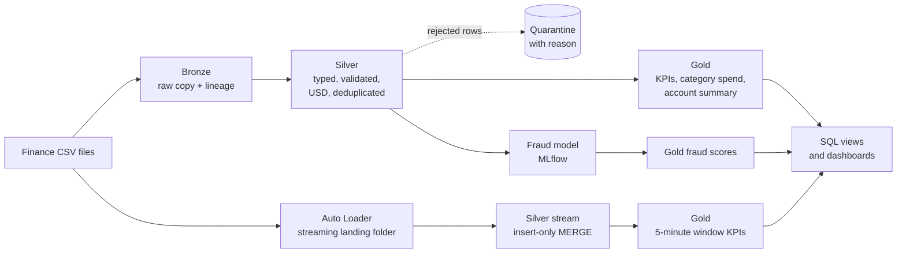

# Finance Data Workflows on Databricks

Batch and streaming data pipelines on Databricks that turn raw finance transaction CSVs into trusted tables for **reporting, analytics and AI**. One dataset flows through a medallion architecture (bronze, silver, gold) on Delta Lake, feeds SQL dashboards, and powers a fraud-scoring model tracked with MLflow.

## The problem this project solves

Finance teams receive transaction data as CSV files from banks, card processors and internal systems. Turning those files into something people can trust runs into the same problems again and again:

| Problem | What goes wrong | How this project handles it |
|---|---|---|
| **Dirty data reaches reports** | Missing amounts, negative values, bad dates and unknown currencies silently distort totals and models | A validation step separates good rows from bad. Bad rows go to a **quarantine table with a reason**, so nothing disappears and nothing pollutes reports |
| **Duplicates and re-runs** | Loading the same file twice double-counts spending | Silver uses **idempotent `MERGE` on the transaction ID**, so re-running never creates duplicates |
| **Mixed currencies** | Adding euros, rupees and dollars together gives meaningless totals | Every amount is converted to **USD** using an exchange-rate table, so aggregates are comparable |
| **Batch only, data arrives late** | Reports are stale because files are processed once a day | An **Auto Loader streaming pipeline** picks up new files incrementally and keeps 5-minute KPIs fresh |
| **Reporting and AI built separately** | The model is trained on different data than the dashboards show | Reporting views, KPIs and the fraud model **all read the same governed silver and gold tables** |
| **Manual, undocumented steps** | Nobody can reproduce or schedule the process | Notebooks are modular, parameterised, and can run as a **scheduled job with task dependencies** |
| **AI evaluated dishonestly** | Random splits leak the future into training, so results look better than they are | The model uses a **time-based split** and behaviour features built only from earlier transactions |

## Architecture

## What is in the project

| File | Purpose |
|---|---|
| `00_common.py` | Parameters, schema, exchange rates, shared cleaning logic, upsert helper, synthetic data generator |
| `01_batch_pipeline.py` | CSV to bronze, silver and gold Delta tables, with a data-quality report |
| `02_streaming_pipeline.py` | Auto Loader into bronze, silver with validation and deduplication, 5-minute window KPIs |
| `03_ai_fraud_model.py` | Feature engineering with window functions, model training, MLflow tracking, batch scoring |
| `04_reporting.py` | SQL views for dashboards and analytics |
| `databricks_job.json` | Scheduled workflow definition with task dependencies |
| `HOW_TO_RUN.md` | Step-by-step run guide |

## Tables produced

| Layer | Table | Contents |
|---|---|---|
| Bronze | `bronze_transactions`, `bronze_stream` | Raw data exactly as received, plus source file and ingestion time |
| Silver | `silver_transactions`, `silver_stream` | Typed, validated, USD-converted, deduplicated transactions |
| Silver | `silver_quarantine`, `silver_stream_quarantine` | Rejected rows with the reason |
| Gold | `gold_daily_kpis` | Daily transaction count, volume, average amount, fraud rate |
| Gold | `gold_category_spend` | Spend by day, merchant category and channel |
| Gold | `gold_account_summary` | Per-account totals, largest transaction, countries used |
| Gold | `gold_stream_window_kpis` | Near-real-time KPIs in 5-minute windows |
| Gold | `gold_fraud_scores` | Fraud probability and flag for every transaction |

## Technology and why it is used

| Technology | Problem it reduces |
|---|---|
| Delta Lake | ACID writes, safe re-runs and `MERGE` upserts, so a failed job never leaves half-written data |
| Medallion layers | Raw data is kept untouched, so any downstream table can be rebuilt |
| Auto Loader and Structured Streaming | Each new file is processed exactly once, with checkpoints that survive restarts |
| `foreachBatch` with `MERGE` | Idempotent streaming writes and in-batch deduplication |
| Unity Catalog and Volumes | Governed tables and files under one catalog, schema and permission model |
| MLflow | Every model run records its parameters, metrics and model artifact, so results are reproducible |
| Spark window functions | Behavioural features (recent activity, spend versus the account's usual) without leaking future data |
| Databricks Jobs | Task dependencies and scheduling in place of manual notebook runs |

## The AI use case

The fraud model flags suspicious transactions so analysts can review the riskiest ones first.

- Features combine the transaction itself (amount, hour, channel, category, country) with account behaviour (activity in the previous hour, amount compared with the account's recent average).
- The data is split **by time**: it trains on the earliest 80% and is tested on the latest 20%, as it would be used in production.
- Results are reported as a **review budget**: if analysts can check only the top 1% riskiest transactions, how much fraud is caught and how precise is the list?
- The scores table marks each row as `train` or `test`, so reports only quote honest held-out numbers.

## Run it

1. Import the five notebooks into one Databricks folder (Workspace, then Import).
2. Attach serverless compute and run `01`, `02`, `03`, `04` in order.
3. To use your own finance CSV, paste its Volume path into the `own_csv_path` widget and map your column names in `COLUMN_MAP` (see `HOW_TO_RUN.md`).

With no CSV supplied, the notebooks generate 30 days of synthetic card transactions, including deliberately dirty rows, so everything runs out of the box.

## Limitations

- The bundled data is **synthetic**. Fraud-model metrics demonstrate the workflow and are not a claim about real-world performance.
- Exchange rates are a fixed demo table. Production would load a maintained rates feed.
- The streaming notebooks use `availableNow` triggers so they work on serverless compute. An always-on stream on a classic cluster needs only a different trigger.
- Scoring uses pandas for simplicity. Very large tables should use `mlflow.pyfunc.spark_udf`.

## Next steps

- Add expectations or Lakeflow declarative pipelines for managed data-quality rules
- Register the model and serve it behind a Databricks model-serving endpoint for real-time scoring
- Add a monitoring job for data drift and score distribution
- Publish an AI/BI dashboard on the `vw_*` views
